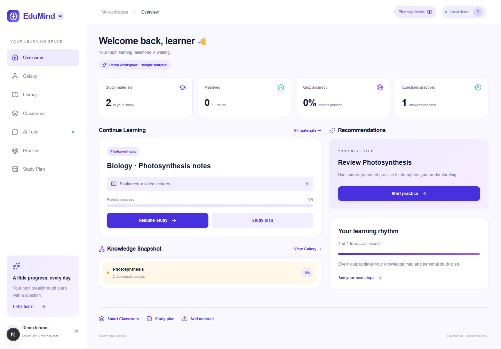
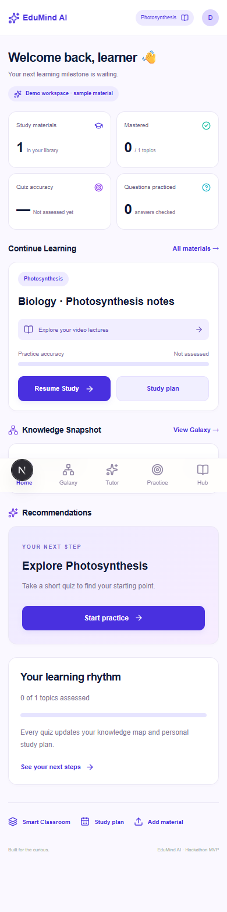
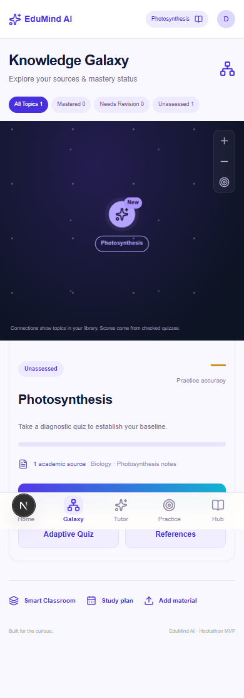
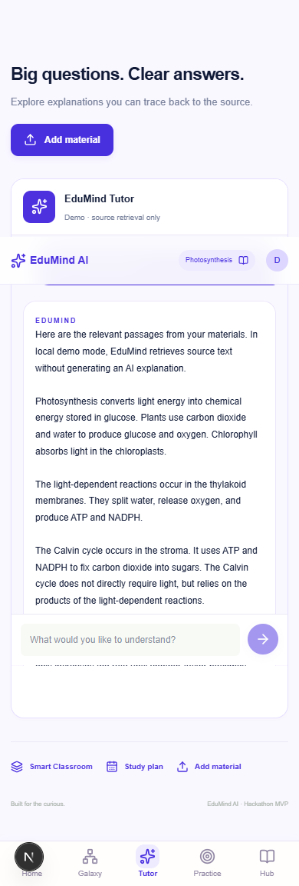
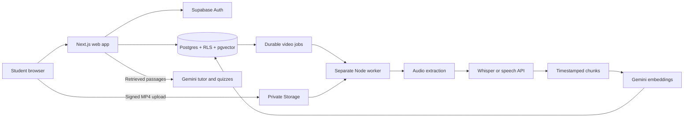

<p align="center"></p>

<p align="center">


</p>

# EduMind AI

**Upload your study materials. Ask questions you can verify. Revisit the exact lecture moment.**

EduMind connects textbooks, slides, notes, and lecture transcripts into one learning workspace. Its tutor retrieves relevant passages before answering, attaches source citations, and turns lecture timestamps into clickable revision links. Practice scores feed a visual Knowledge Galaxy and a personalized study plan.

The interface adapts the supplied Google Stitch designs: a violet dashboard, source workspace, and knowledge map. Phones use fixed bottom navigation; laptops retain the left sidebar.

> This is a hackathon MVP. Demo mode, live generation, and provider fallbacks are explicitly labeled. Mastery represents cumulative quiz accuracy, not a validated educational assessment.

## Explore

- **Live app:** see the verified address and service availability in [Deployment status](docs/DEPLOYMENT.md).
- [Smart Classroom operator guide](docs/SMART_CLASSROOM.md)
- [Cloud integration evidence](docs/cloud-verification.json)
- [Interface verification](docs/stitch-verification.json)

## Interface preview



<table>
<tr><td align="center"><strong>Dashboard</strong></td><td align="center"><strong>Knowledge Galaxy</strong></td><td align="center"><strong>Grounded tutor</strong></td></tr>
<tr><td></td><td></td><td></td></tr>
</table>

## Features

| Feature | What it does |
| --- | --- |
| Private workspace | Supabase email/password authentication, user-owned records, and private storage |
| Material ingestion | PDF pages, PPTX slides, TXT/MD sections, and VTT/SRT captions retain source locations |
| Grounded RAG tutor | pgvector semantic retrieval followed by cited Gemini explanations |
| Smart Classroom | Direct MP4 uploads, HTML5 playback, seeking, speed, captions, and official YouTube embeds |
| Video citations | Open the cited lecture and seek to its retained timestamp |
| Automatic transcription | Durable background jobs, FFmpeg extraction, and actual timestamped speech recognition |
| Adaptive quizzes | Topic-based difficulty and source-supported questions; incorrect answers link to revision passages |
| Knowledge Galaxy | Topic selection, score filters, and zoom; connections reflect library membership |
| Personalized plans | Prioritize unassessed and lower-scoring topics |
| Smart notes | Transcript search, timestamped notes, resume position, and source comparison |
| Honest fallback | Busy AI providers return labeled passages or source-check questions |

## Architecture



Videos never undergo long transcription in a web request. A worker claims a lease, heartbeats during processing, and publishes complete transcript segments and vectors atomically. Expired leases can be reclaimed; failed jobs remain visible and can be retried.

**Stack:** Next.js 16, React 19, TypeScript, Tailwind CSS 4, Lucide, Supabase Auth/Postgres/Storage, pgvector, Gemini, FFmpeg/FFprobe, and faster-whisper/FastAPI. Vectors use 768 normalized dimensions.

## Quick start

Install Node.js 24 and npm:

```bash
git clone https://github.com/raghavg1024-stack/edumind-ai.git
cd edumind-ai
npm ci
cp .env.example .env.local
npm run dev
```

On Windows, use `Copy-Item .env.example .env.local` in place of `cp`.

Open [localhost:3000](http://localhost:3000). Demo mode includes photosynthesis notes and a short narrated lecture. Learning data is stored in your browser; local video previews and notes remain in the current session. Demo tutoring retrieves passages without calling an AI provider.

### Enable accounts and live AI

Create a Supabase project and Gemini API key. Populate the web settings in `.env.local`. For a **fresh database only**, apply these SQL files in the Supabase SQL editor in order:

1. `supabase/schemas/edumind.sql`
2. `supabase/schemas/smart_classroom.sql`
3. `supabase/schemas/video_jobs.sql`

These are desired schema definitions. Do not rerun them over an existing project; back up your database and generate/review migrations instead. Set the Supabase Auth Site URL and redirect allowlist for local and production origins. Email confirmation depends on your project's Auth settings. Use the account button to sign in to the live workspace.

### Enable automatic transcription

Install Python 3.11, FFmpeg, and FFprobe on a host that supports long-running processes. Web, job worker, and speech API are separate services.

```bash
python -m venv .venv
# Activate the environment using your operating system's command.
pip install -r worker/speech-requirements.txt
python worker/speech_api.py
```

Configure the worker environment:

```dotenv
VIDEO_WORKER_ENABLED=true
VIDEO_TRANSCRIPTION_ENABLED=true
VIDEO_WORKER_SUPABASE_KEY=your_server_only_worker_key
STT_PROVIDER=http
STT_API_URL=http://127.0.0.1:8787/transcribe
```

Then run `npm run worker:video` in another terminal. The default English `tiny.en` Whisper model runs on CPU and downloads weights on first use. Set `WHISPER_MODEL` for a larger/multilingual model. Check recognition quality before relying on a transcript.

Alternatively, configure Deepgram or an HTTP speech provider returning actual timed segments. See the [speech contract](docs/SMART_CLASSROOM.md). Web Speech API is not used as a replacement for background prerecorded transcription.

## Environment reference

| Variable | Service | Purpose |
| --- | --- | --- |
| `NEXT_PUBLIC_SUPABASE_URL` | Web + worker | Supabase endpoint |
| `NEXT_PUBLIC_SUPABASE_PUBLISHABLE_KEY` | Web | Public browser key; never a secret/service-role key |
| `GEMINI_API_KEY` | Web + worker | Private generation/embedding credentials |
| `GEMINI_MODEL` | Web | Verified generation default: `gemini-3.8-flash` |
| `GEMINI_EMBEDDING_MODEL` | Web + worker | `gemini-embedding-001`; model changes require reindexing |
| `NEXT_PUBLIC_UPLOAD_MAX_MB` | Web | `4` on Vercel, default `8` locally |
| `VIDEO_WORKER_ENABLED` | Web | Enable enqueue controls only with a running worker |
| `VIDEO_TRANSCRIPTION_ENABLED` | Web | Enable transcription with a running speech service |
| `VIDEO_WORKER_SUPABASE_KEY` | Worker only | Privileged key for job leases and private storage |
| `STT_PROVIDER` | Worker | `http` or `deepgram` |
| `STT_API_URL`, `STT_API_KEY`, `STT_MODEL` | Worker | HTTP speech endpoint and optional credentials/model |
| `DEEPGRAM_API_KEY` | Worker | Alternative speech provider key |
| `FFMPEG_PATH`, `FFPROBE_PATH` | Worker | Optional executable paths |

Real environment files, Vercel credentials, local logs, speech environments, and model caches are excluded from Git. `.env.example` contains placeholders only. Rotate any key accidentally shared outside its intended secret store.

## Vercel deployment

1. Import this repository as Next.js; use the repository root, Node.js 24, and default build settings.
2. Set web variables in Vercel. Store `GEMINI_API_KEY` as a sensitive server variable.
3. Set `NEXT_PUBLIC_UPLOAD_MAX_MB=4` to leave room below Vercel's multipart request limit.
4. Deploy, then configure the production origin in Supabase Auth URL settings.
5. Host the worker and speech API separately before enabling their web flags.

**Vercel hosts the web app.** This deployment does not run a permanent FFmpeg/Whisper worker inside Vercel Functions. Manual transcript uploads, searchable captions, and timestamp citations work without automatic processing. MP4s upload directly to Supabase Storage, outside Vercel's document request body limit.

Worker Dockerfiles are supplied but their hosted deployment has not been verified. The live web deployment must not be interpreted as a completed speech-worker deployment. See [Vercel limits](https://vercel.com/docs/functions/limitations) and [Supabase redirect configuration](https://supabase.com/docs/guides/auth/redirect-urls).

## Hackathon walkthrough

1. Inspect real material and quiz counts on the dashboard.
2. Open Smart Classroom and play the photosynthesis sample.
3. Search “Calvin” and click a transcript timestamp to seek.
4. Ask about the Calvin cycle and open a tutor citation.
5. Complete a topic quiz and follow an incorrect answer's revision link.
6. Inspect updated scores in Knowledge Galaxy and the study plan.
7. Sign in for private uploads and configured Gemini generation.

## Tests and verification

```bash
npm run lint
npm test
npm run build
# Running app + installed Chrome:
node scripts/verify-stitch.mjs
node scripts/verify-classroom-inputs.mjs
# Configured cloud services + local speech/FFmpeg:
npm run verify:classroom:stack
```

The 15 automated tests cover parsers, retrieval, actual FFmpeg extraction, timestamp validation, pgvector-backed database behavior, tenant isolation, job leases, atomic publication, and idempotent grading. GitHub Actions runs lint, tests, and the build on pushes and pull requests without production keys.

Recorded local cloud tests passed for signed uploads, private playback, actual recognized speech concepts, timestamp validity, vector indexing, generated cited tutoring, generated quizzes, revision links, notes, and score updates. Browser tests passed for mobile/laptop navigation, Stitch screens, quiz revision, and file/URL input switching. These reports do not claim every production browser and hosting configuration has been tested.

## Project structure

```text
src/app/                 Pages, design styles, API routes
src/components/          Classroom, player, dashboard, Galaxy
src/lib/                 Ingestion, retrieval, AI, speech, validation
supabase/schemas/        Desired database, RLS, storage, job definitions
worker/                  Video worker and speech API
tests/                   Unit, media, database tests
scripts/                 Supervisors and end-to-end checks
public/samples/          Known-spoken lecture and authored captions
docs/                    Guides, screenshots, redacted test evidence
.github/workflows/       CI quality checks
```

## Limitations and roadmap

- PDFs need extractable text; OCR and legacy `.ppt` are not implemented.
- Documents: 4 MB on Vercel, 8 MB locally, maximum 100 pages/slides. MP4: 50 MB; H.264/AAC recommended.
- Manual lecture duration: up to four hours. Automatic processing: up to one hour.
- YouTube uses the official embed; owner/region restrictions can block playback. Captions are never scraped; upload permitted transcripts when needed.
- Whisper recognition and timing need review; they are not perfect annotations.
- Gemini capacity, quota, and model availability vary. Labeled fallbacks remain usable during temporary outages.
- Galaxy connections show library membership; prerequisite inference and locked pathways are not implemented.
- Rate limiting, billing controls, load testing, a broader accessibility audit, and a validated learning model are future production work.

Contributions should preserve source provenance, timestamp accuracy, tenant isolation, and honest fallback labels. Include relevant checks and update these instructions when behavior changes.
